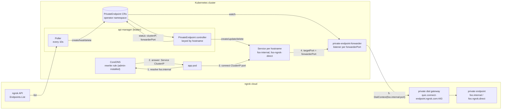
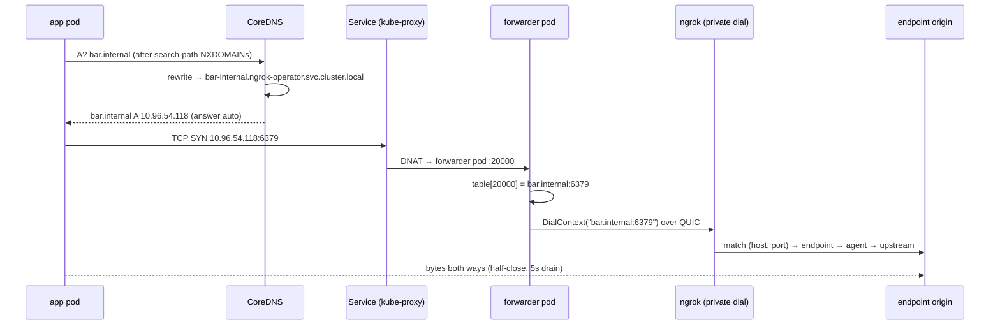

# Private endpoints in Kubernetes: strategy

Internal strategy doc for operator developers and the ngrok product team. Not user-facing.

It covers how in-cluster access to ngrok private endpoints works in the current proof of
concept (POC), how it compares to Kubernetes bindings (which it replaces), its known
limitations, and what is still undecided. Code claims cite file paths on the
`alex/private-endpoints-poc` branch and describe the current working tree, which includes
fixes still in review. Anything not checked against code or a recorded test is marked
**unverified**.

Related docs: [README.md](README.md) (tracker: risks R1–R19, decisions D1–D8),
[requirements.md](requirements.md) (requirements, verification, gaps), [design.md](design.md),
[notes.md](notes.md), [findings.md](findings.md), [research/](research/00-summary.md),
[runbooks/](runbooks/).

---

## 1. Summary

**What.** Any pod in a cluster running the ngrok operator can reach any ngrok private
endpoint in the operator's account by its real URL, such as `https://foo.ngrok.direct` or
`tcp://bar.ngrok.direct:6379`. It works for http, https, tls and tcp. `.ngrok.direct` endpoints
are mirrored by default; `.internal` ones (`http://foo.internal`) are opt-in (D8). Users don't
create any per-endpoint Kubernetes config, sidecar or app change. A cluster admin makes one DNS
change.

**How.** The operator polls the ngrok API and mirrors each private endpoint into a
`PrivateEndpoint` resource. It gives each hostname a ClusterIP Service and gives each endpoint
its own port on a forwarder Deployment. A CoreDNS rewrite maps `foo.ngrok.direct` to that
hostname's Service. The forwarder copies bytes to the endpoint over ngrok **private dial**. It
never parses HTTP, never terminates TLS, and doesn't run its own DNS server.

**Why.** Kubernetes bindings (`BoundEndpoint`) only expose endpoints that were explicitly
bound to the cluster, and only under a made-up `service.namespace` name rather than the
endpoint's real hostname. Because the name isn't the real one, TLS verification and
hostname-based apps don't work. Private endpoints and private dial are where the platform is
heading, and this design uses them as intended.

**Current state.** The POC is built and passed a live end-to-end test in kind for http, https
with verification on, tls passthrough, tcp/redis, two ports on one hostname, both TLDs, and
cleanup within one poll cycle. Fixes for the review findings are in the working tree, pending
review. They cover Service ownership, port reuse, poller drift, forwarder bind errors and a
Helm token check. DNS setup is documented only for kind. Validation on EKS and k3s comes next.

**Biggest open questions.**

1. **DNS on real platforms (D1).** The CoreDNS rewrite only works where an admin can add
   rewrite rules to CoreDNS. It doesn't work with GKE kube-dns or Cloud DNS, and it isn't the
   supported path on OpenShift. A small ngrok DNS server behind a conditional forward is the
   likely portable answer, but it isn't built.
2. **Access control.** Today every private endpoint in the account is reachable from every
   pod in the cluster. Is that acceptable for a preview? What should the long-term model be?
3. **Identity.** Unlike bindings, the new path sends no pod identity, so Traffic Policy can't
   match on the calling workload. This needs backend work.
4. **Multiple installs per cluster (D6).** DNS can send each suffix to one operator. A
   per-cluster base domain (`foo.mycluster.ngrok.direct`) would fix this, but needs an agent
   `baseDomain` setting ngrok doesn't have yet, plus multi-label hostname support.

`.internal`'s future was open here; it is now settled by D8 (`.ngrok.direct` is the prescribed
pattern, `.internal` is opt-in).

---

## 2. Background

### 2.1 Private endpoints

An ngrok private endpoint has exactly one URL under one of two TLDs. It has no public ingress.
Only other ngrok endpoints and private dial clients holding account credentials can reach it.

| TLD | Public cert possible | Notes |
|---|---|---|
| `.internal` | No. ICANN reserved it for private use, so it will never be delegated publicly | The original private TLD. Endpoints using it exist and are used outside browsers |
| `.ngrok.direct` | Yes. ngrok owns the domain and serves a publicly trusted `*.ngrok.direct` cert | Created because browsers reject certs for `.internal`. The prescribed pattern going forward (PM, 2026-10-12); `.internal` stays supported but secondary |

ngrok API behavior the design depends on (ngrok-api-go v9, recorded in
[findings.md](findings.md)):

- `Endpoints.List` has no server-side filter, so the operator filters on the client.
- `Scheme`, `Host` and `Port` come back empty in list results, so everything is parsed from `URL`.
- Both TLDs currently report `bindings: ["internal"]`. That binding value is expected to be
  renamed to `private`. The poller filters on hostname suffix, so the rename won't affect it.
- A `tls://` URL comes back with an explicit `:443`.
- Pooled endpoints share one URL.

### 2.2 Private dial

`golang.ngrok.com/ngrok/privatedial` gives a client a raw byte stream to an endpoint, given
`host:port`:

- `Dialer.DialContext(ctx, "tcp", "foo.internal:6379")`. ngrok matches `(host, port)` to the
  endpoint on the server side.
- Authenticated with an ngrok access token (PAT). The operator already authenticates with a PAT.
- Transport is HTTP/3 over QUIC to `connect-endpoint.ngrok.com`, with an HTTP/2 fallback. One
  session carries many dials, and each dial has a 5s budget.
- Client metadata can be sent per session, but Traffic Policy can't see it yet, so there is no
  per-connection identity.
- It isn't on ngrok-go `main`. The operator pins feature-branch commit `e2b70148`
  (`go.mod`: `golang.ngrok.com/ngrok/privatedial v0.0.0-20260616091145-e2b70148b6de`).

The key consequence: **a client only needs to know which hostname and port a connection is
for.** It never has to read the HTTP Host header or the TLS SNI. One IP per hostname, with the
destination port passed through, is enough. ngrok's agent v4 uses the same model on
workstations: a TUN device, a local resolver, one synthetic IP per hostname, and the port
passed through.

### 2.3 Why replace Kubernetes bindings

Bindings is the existing in-cluster access story (`api/bindings/v1alpha1/`,
`internal/controller/bindings/`). Its problems:

- **Opt-in per endpoint, on the ngrok side.** An endpoint must be created with the
  `kubernetes` binding and must match the operator's `endpointSelectors` (CEL,
  `api/ngrok/v1alpha1/kubernetesoperator_types.go`).
- **Fake hostnames.** The URL must look like `<scheme>://<service>.<namespace>:<port>`
  (`BoundEndpointSpec.EndpointURL` pattern), and the operator projects a Service with that name.
  Clients never use the endpoint's real hostname, so TLS certs and hostname-aware apps don't
  line up.
- **Separate transport.** The bindings forwarder dials a dedicated ngrok ingress
  (`kubernetes-binding-ingress.ngrok.io:443`) over mTLS, using a cert issued to the
  registered `KubernetesOperator`. It then upgrades the connection with a custom binding
  protocol (`internal/controller/bindings/forwarder_controller.go`). Private dial is the
  general-purpose replacement for this path.

The direction is set: DNS-based private dial, a new CRD, and no `kubernetes` binding carried
forward. Bindings is deprecated alongside the new feature, not removed by this work.

---

## 3. Goals, non-goals, requirements

### Goals

- Any pod reaches any private endpoint by its real URL over http, https, tls and tcp.
- No per-endpoint Kubernetes config, no sidecar, no app change. One admin DNS step is allowed.
- Runs alongside bindings, so users can migrate.
- Keep as little low-level networking code in the operator as possible. Push generic dial and
  forward code into the SDK.

### Non-goals for the POC

These are deferred, not rejected:

- Access control (which pods or namespaces may reach which endpoints).
- Per-pod identity on the dial.
- Operator-managed DNS changes on any platform.
- Multi-label hostnames (`api.foo.internal`).
- IPv6 and dual-stack.
- Scale beyond about 1000 endpoint-ports per cluster.
- Multiple operator installs or accounts per cluster (D6).
- Moving the operator's own Ingress/Gateway translation to `.ngrok.direct` (post-1.0, §10).

### Requirements honored

Summary below. The full list (R-1–R-18), how each is verified, and the gaps to close are in
[requirements.md](requirements.md).

| ID | Requirement | State |
|---|---|---|
| R-1 | Real hostnames; `*.ngrok.direct` TLS verifies with ngrok's public cert | Verified in kind |
| R-2 | All schemes: http, https, tls, tcp | Verified in kind |
| R-3 | No per-endpoint K8s config, sidecar or app change (one-time admin DNS step) | Met |
| R-4 | New CRD that coexists with bindings; `kubernetes`-bound endpoints are never picked up | Met (`poller.go` `desiredSpecs`) |
| R-5 | Forwarder is bytes-only: no DNS server, no Host/SNI parsing, no TLS | Met |
| R-6 | Poller never mass-deletes on an API error | Met, tested |
| R-7 | Feature is off by default and does nothing without the CRD installed | Off by default: met. On without the CRD: the api-manager used to fail to start (research/07 PR-1); now it warns and disables the feature. Fixed (working tree), unit-tested, not run live |
| R-8 | Only `.ngrok.direct` is mirrored by default; `.internal` is opt-in (D8) | Working tree, unit + Helm tests |

---

## 4. How it works

### 4.1 Architecture



There are three components, plus one admin-owned DNS change:

| Component | Where it runs | Code |
|---|---|---|
| Poller | api-manager, leader only | `internal/controller/privateendpoints/poller.go` |
| PrivateEndpoint controller | api-manager | `internal/controller/privateendpoints/controller.go` |
| Forwarder | new `private-endpoint-forwarder` subcommand and Deployment | `cmd/private-endpoint-forwarder.go`, `internal/privateendpoints/forwarder/` |
| Naming and URL rules | shared | `internal/privateendpoints/naming.go` |
| CoreDNS rewrite | kube-system, installed by an admin | kind helper: `scripts/kind-private-endpoints-dns.sh` |

The api-manager wiring is in `cmd/api-manager.go` (`enablePrivateEndpointsFeatureSet`), behind
`--features-private-endpoints-enabled`.

### 4.2 Control plane

#### The `PrivateEndpoint` CRD

`PrivateEndpoint` (`ngrok.com/v1`, namespaced; `api/ngrok/v1/privateendpoint_types.go`) is a
mirror of one private endpoint URL plus its in-cluster wiring. Users aren't meant to author
these resources, but nothing enforces that (research/07 PR-7).

```yaml
apiVersion: ngrok.com/v1
kind: PrivateEndpoint
metadata:
  name: pe-<sha256(url)[:16]>
  namespace: ngrok-operator
  labels:
    ngrok.com/managed-by: private-endpoint-poller
    ngrok.com/private-endpoint-host: <sha256(hostname)[:16]>
spec:
  url: tcp://bar.internal:6379
  scheme: tcp          # http | https | tls | tcp
  hostname: bar.internal
  port: 6379           # defaulted: http 80, https 443, tls 443; tcp requires an explicit port
status:
  clusterIP: 10.96.54.118
  forwarderPort: 20000
  conditions: [{type: Ready, ...}]
```

Every scheme gets a `forwarderPort` in the current design. The CRD's field comment used to
mention a "shared http/https listener" left over from revision 1; the fix is in the working
tree (R17).

#### Poller

`poller.go` runs as a manager runnable. That means it runs on the leader only, because it
doesn't opt out of leader election. On each tick:

1. It lists all endpoints in the account (`Endpoints.List`, paginated). **If the list fails,
   it changes nothing.** An API outage can't delete resources (R-6).
2. It keeps endpoints whose hostname ends in `.ngrok.direct`, or `.internal` when opted in
   (`--features-private-endpoints-include-internal`, D8), and that are **not** `kubernetes`-bound. Pooled
   endpoints collapse into one entry per URL.
3. It compares that set to the `PrivateEndpoint` resources carrying its managed-by label, then:
   - creates the missing ones;
   - **heals drift** (working tree, R3): it puts back the spec and the poller-owned labels if
     someone edited them, and leaves other labels and status alone;
   - deletes labeled resources whose endpoint is gone;
   - logs and skips a same-named resource that lacks the label. It never adopts a resource it
     didn't create.

The interval is fixed at 10s in `cmd/api-manager.go`.

#### Controller

`controller.go` is **keyed by hostname, not by resource**. Every endpoint on one hostname must
share the single IP that DNS returns, so the hostname is the unit of work. The request name is
`HostKey(hostname)`, and the controller is fed by watches on `PrivateEndpoint` and Service
objects that map through the `ngrok.com/private-endpoint-host` label.

For each hostname:

1. It lists all `PrivateEndpoint` resources **uncached** (`APIReader`), so back-to-back
   reconciles can't hand out the same forwarder port because of a stale cache. The controller
   runs with `MaxConcurrentReconciles: 1`, because port allocation assumes one worker.
2. It computes the Service name with `ServiceName(hostname)` (see Naming below). If the
   hostname can't be mapped, every resource on it gets `Ready=False`,
   reason `UnsupportedHostname`.
3. It builds one Service port per endpoint: `port: spec.port` → `targetPort: forwarderPort`.
   Two endpoints on the same hostname and port produce `PortConflict` for the loser. Running
   out of forwarder ports produces `PortsExhausted` and a 30s recheck.
4. It applies the Service with `CreateOrUpdate`. **Ownership check** (working tree, R1): if a
   Service with that name exists but doesn't carry this controller's managed-by and host labels,
   the controller leaves it alone, marks the resources `ServiceConflict`, and rechecks every
   30s. It polls because the Service watch only maps labeled Services, so nothing would trigger
   a reconcile when the foreign Service goes away.
5. It writes `status.clusterIP`, `status.forwarderPort` and `Ready=True`. If the Service has
   no ClusterIP yet, it sets `Ready=False`, reason `ServiceNotReady`, and requeues after 2s.
6. When the last endpoint on a hostname disappears, it deletes the hostname's Services, found by
   label. There is no finalizer and no ownerRef.

**Ready condition reasons:** `Ready`, `UnsupportedHostname`, `PortConflict`, `PortsExhausted`,
`ServiceConflict`, `ServiceNotReady`.

#### Naming

From `naming.go`:

| Hostname | Service name | Rule |
|---|---|---|
| `foo.internal` | `foo-internal` | label + `-internal` |
| `foo.ngrok.direct` | `foo-ngrok-direct` | label + `-ngrok-direct` |
| `api.foo.internal` | unsupported | Service names can't contain dots |
| `Foo.Internal.` | `foo-internal` | lowercased, trailing dot trimmed |

The label must be a valid DNS-1035 label: lowercase letters, digits and `-`, starting with a
letter. It can be at most 54 characters before `.internal` or 50 before `.ngrok.direct`, so the
Service name stays within 63. The TLD suffix keeps `foo.internal` and `foo.ngrok.direct`, which
are different endpoints, on different Services. Resource names hash the URL and host labels
hash the hostname, so neither exposes length or character limits.

#### Forwarder port allocation

- The range is **20000–20999 (1000 ports)**, hard-coded in `cmd/api-manager.go` and not exposed
  as a Helm value.
- Each endpoint, meaning each `(hostname, port)` pair, holds one port. That port is stored in
  `status.forwarderPort`, which is the source of truth. There is no separate allocator state.
- **Cursor allocation** (working tree, R2): `allocate` hands out the next free port after the
  last one it allocated and wraps to the start of the range. A freed port is reused only after
  the rest of the range has been cycled through. This gives lagging forwarder replicas time to
  drop the old mapping.
- The cursor lives in memory. On a restart or leader change it is reseeded from the highest
  port in use, so a port freed above every remaining port can be reused straight away (R12,
  accepted for the POC).
- If two hostnames claim the same port (only possible from earlier bugs or manual edits), the
  resource with the lowest name keeps it and the other is reassigned.

#### Status and readiness semantics

`Ready=True` means **configured**: the Service exists with a ClusterIP and a forwarder port is
assigned. It does **not** mean:

- that any forwarder replica has bound the listener;
- that cluster DNS has the rewrite installed;
- that the endpoint is reachable through private dial.

This is a deliberate POC limitation (research M1).

### 4.3 Data plane

#### Forwarder

`cmd/private-endpoint-forwarder.go`, `internal/privateendpoints/forwarder/syncer.go`:

- It watches `PrivateEndpoint` resources in its own namespace only, through a namespace-scoped
  cache. It runs without leader election, so every replica serves every port.
- On each change, `Syncer.Sync` rebuilds a `forwarderPort → host:port` table from every
  resource that has both `status.clusterIP` and `status.forwarderPort` set. It then opens
  listeners for new ports and closes listeners for ports that are gone. Listeners come from the
  existing `pkg/bindingsdriver`, which binds `0.0.0.0:<port>`.
- **The target is looked up when a connection is accepted, not when the listener opens**
  (`Syncer.handler`). A port reassigned to a different endpoint routes to the new target
  without reopening the listener. If the port isn't in the table, the connection is closed.
- Readiness (`/readyz`) requires the table to have synced at least once **and** that the last
  sync hit no listener bind errors (working tree, R5). A startup bind failure no longer
  crashloops the pod. It fails readiness and is retried with backoff. Liveness never depends on
  ngrok being reachable, because a remote outage shouldn't cause restart loops.
- One `privatedial.Dialer` per process, forced to `ProtocolQUIC`, using the PAT from
  `NGROK_ACCESS_TOKEN`. The server address defaults to `quic.connect-endpoint.ngrok.com:443`
  (`--private-dial-server`). QUIC is forced because the HTTP/2 transport failed on Go 1.27 in
  testing. **This means the cluster needs UDP/443 egress.**

#### Connection handling

`privatedial_forward.go` is deliberately isolated so it can move upstream:

- `ForwardConn` dials the target. On failure it closes the client connection, which looks like
  a reset or EOF to the client, and logs the error.
- `join` copies bytes both ways. At EOF, each direction half-closes its destination
  (`CloseWrite`).
- Once either direction finishes, the other gets a **5s drain** before both are closed. This
  matches agent v4. It stops a client that never closes from pinning a stream. But a client
  half-close also starts the drain, so a client that shuts down its write side gets the full
  response **only if it arrives within 5s** (confirmed cut-off, research/07 PR-2). Any one-way
  stream that runs longer than 5s after the other side ends is cut (R8).
- There is no idle timeout. Copy errors are discarded.

### 4.4 DNS

#### What we do now: CoreDNS rewrite onto Service names

The admin adds two rules to the main `.:53` server block (kind helper:
`scripts/kind-private-endpoints-dns.sh`, run by `make kind-private-endpoints-dns`):

```
rewrite stop name regex ^([a-z][a-z0-9-]*)\.internal\.$     {1}-internal.<ns>.svc.cluster.local.     answer auto
rewrite stop name regex ^([a-z][a-z0-9-]*)\.ngrok\.direct\.$ {1}-ngrok-direct.<ns>.svc.cluster.local. answer auto
```

- Only **single-label** names match. `metadata.google.internal` and other multi-label
  `.internal` names keep resolving upstream. This was verified in kind with a temporary `hosts`
  entry.
- `answer auto` makes the reply carry the name the client asked for.
- The rewrite matches by **syntax, not by known endpoints**. Any single-label
  `<x>.internal` is sent to `<x>-internal.<ns>.svc`, which returns NXDOMAIN if no such Service
  exists. That is how a name that isn't one of ours stops resolving through its old path (§6).
- Unknown `.ngrok.direct` names also get NXDOMAIN. Because ngrok owns that domain, this is the
  same answer they'd get anyway, apart from caching.
- Search-path expansion runs first. With the default `ndots:5`, `foo.internal` is tried as
  `foo.internal.<ns>.svc.cluster.local` and similar names before the absolute name, which costs a
  few extra NXDOMAINs per lookup.

Per D8, the kind helper installs only the `.ngrok.direct` rule by default and adds the
`.internal` rule with `PE_INCLUDE_INTERNAL=true`, matching the operator's `includeInternal`
setting. This is also what the research playbooks recommended.

#### Why not our own DNS server (revision 1 history)

Revision 1 (the plan is in [plan.md](plan.md), now history) ran an authoritative DNS server for
`internal.` and `ngrok.direct.` inside the forwarder:

- CoreDNS stub-forwarded both zones to it.
- Shared :80 and :443 listeners routed http, https and tls by Host header or SNI.
- tcp got per-host Services.
- Unknown `.internal` names were forwarded to the node's upstream resolver. The forwarder pod
  used `dnsPolicy: Default` to avoid a loop.

It was built, tested in kind, and removed. Kubernetes Services already give us an IP and a DNS
name per hostname, so a rewrite onto a Service per hostname does the same job with far less of
our own DNS and HTTP/TLS sniffing code to support. It also fits private dial's `(host, port)`
model better than Host/SNI routing does. Revision 1 did handle things revision 2 can't:
multi-label names, arbitrary labels, and fewer Services. A DNS server, now without the Host/SNI
routing, is the leading option for portability (§8, D1).

### 4.5 Helm and install

`helm/ngrok-operator/templates/private-endpoints/`:

- **`ngrok.features.privateEndpoints.enabled`** (default `false`) gates everything.
- **`ngrok.features.privateEndpoints.includeInternal`** (default `false`) also mirrors `.internal` endpoints
  (D8). It must be paired with an `.internal` rewrite in cluster DNS.
- **Forwarder Deployment** (`deployment.yaml`), configured under `components.privateEndpointForwarder`
  (inherits `components.common`), with `replicaCount` defaulting to 1, plus a
  ServiceAccount and a namespace-scoped Role that can only read `privateendpoints`.
- **api-manager Role** in the release namespace: `privateendpoints` create, update and delete
  (update is needed for drift healing, R19),
  `privateendpoints/status` update, and full access to Services. The feature settings are
  ordinary `internal/flags` settings delivered as env; only the api-manager reads them.
- **Token:** the forwarder reads `PRIVATE_ENDPOINTS_ACCESS_TOKEN` from the credentials secret,
  falling back to `ngrok.credentials.accessToken`. Rendering the chart **fails** if no token source
  is configured (working tree, R6). A custom `ngrok.credentials.secret.name` can't be checked at render
  time, so the key requirement is documented instead.
- **CRD** lives in the ngrok-crds chart (`ngrok.com_privateendpoints.yaml`), which the operator
  chart pulls in as a subchart when `installCRDs=true` (the default). Shipping it needs a
  ngrok-crds chart version bump. With the feature on and the CRD missing, the api-manager
  logs a warning and disables the feature (PR-1; fixed in the working tree, unit-tested, not
  run live).
- **DNS is not in the chart.** The operator never edits cluster DNS (decision D4).

Install privileges: the Helm release needs only namespace-scoped RBAC for this feature. The
DNS step needs whatever privilege the platform's DNS owner requires: kube-system ConfigMap
write, the EKS add-on API, the OpenShift DNS Operator, and so on. That is a separate admin task.

### 4.6 TLS behavior by scheme

The forwarder never touches TLS. What the client sees depends on the endpoint's scheme:

| Endpoint | Who terminates TLS | Client verification |
|---|---|---|
| `http://foo.internal` / `http://foo.ngrok.direct` | No TLS on the client leg; the private dial transport is QUIC/TLS | n/a |
| `https://foo.ngrok.direct` | ngrok, with a publicly trusted `*.ngrok.direct` cert | Works with verification on (verified in kind) |
| `https://foo.internal` | ngrok. A public cert isn't possible; the exact cert presented is **unverified** | Clients must skip verification or trust whatever CA signs it |
| `tls://foo.internal` / `tls://foo.ngrok.direct` | The origin (end to end) | Client must trust the origin's cert. A private CA works for `.internal` |
| `tcp://bar.internal:6379` | n/a (raw bytes) | n/a |

Traffic Policy on https endpoints runs at L7 inside ngrok, because ngrok terminates TLS there.

### 4.7 Request walk-throughs

The control plane is the same for every scheme. Within about one poll cycle (10s) of the
endpoint starting, a `PrivateEndpoint` exists, its hostname Service has a ClusterIP, and every
forwarder replica has a listener on its `forwarderPort`.



**http:** `curl http://foo.internal`. The name resolves to `foo-internal`'s ClusterIP. The
connection to port 80 reaches the forwarder port for `http://foo.internal`, which dials
`foo.internal:80`. ngrok receives the HTTP request unchanged, including `Host: foo.internal`,
and runs the endpoint's Traffic Policy.

**https (`.ngrok.direct`):** `curl https://foo.ngrok.direct`. The flow is the same on port
443. The client's ClientHello (SNI `foo.ngrok.direct`) passes through untouched, ngrok
terminates TLS with the `*.ngrok.direct` cert, and verification succeeds. If the same hostname
also has an `http://` endpoint, the one Service carries both ports (80 and 443), each going to
its own forwarder port.

**tls:** `openssl s_client -connect foo.internal:443 -servername foo.internal`. The bytes reach
the origin. ngrok routes on `(host, port)` and passes TLS through, and the client sees the
origin's own cert.

**tcp:** `redis-cli -h bar.internal -p 6379 PING`, as in the diagram above. Returns `+PONG`.

**Endpoint removed:** within one poll, the resource and the port on the Service go away. If
that was the hostname's last endpoint, the Service goes too and DNS returns NXDOMAIN once
caches expire. A connection to a port that a still-existing hostname no longer serves **times
out** instead of being refused, because the Service has no such port (R7, accepted).

---

## 5. Comparison with Kubernetes bindings

### 5.1 Side by side

| Aspect | Bindings (`BoundEndpoint`) | Private endpoints (this design) |
|---|---|---|
| **Opt-in model** | Per endpoint, on the ngrok side: the endpoint is created with the `kubernetes` binding and must match the operator's `endpointSelectors` CEL | None. Every private endpoint in the account is mirrored. `kubernetes`-bound endpoints are excluded |
| **Discovery** | Poller every 10s lists bound endpoints for this registered operator (`boundendpoint_poller.go`) | Poller every 10s lists all account endpoints and filters on the client side (`poller.go`) |
| **Hostname clients use** | `service.namespace` from the endpoint URL convention, not the endpoint's real name | The endpoint's real URL (`foo.internal`, `foo.ngrok.direct`) |
| **K8s objects per endpoint** | One `BoundEndpoint`. An ExternalName "target" Service in the target namespace, pointing at a ClusterIP "upstream" Service in the operator namespace | One `PrivateEndpoint` per URL. One ClusterIP Service per **hostname** in the operator namespace, with one port per endpoint |
| **DNS requirements** | None. Normal Kubernetes Service DNS | One admin-installed CoreDNS rewrite. Platform-specific, and not possible on some platforms today |
| **Namespace placement** | The endpoint picks the target namespace (`<svc>.<ns>`) | Everything lives in the operator namespace. Names are global to the cluster |
| **TLS** | Hostname is `svc.ns`, so a publicly trusted cert can't match. Details **unverified** | `.ngrok.direct` https verifies with a public cert. tls is end to end. `.internal` https can't have a public cert |
| **Protocols** | tcp, http, https, tls (`Scheme` enum) | http, https, tls, tcp |
| **Transport** | mTLS over TCP/443 to `kubernetes-binding-ingress.ngrok.io`, then a custom binding upgrade protocol | Private dial over QUIC (UDP/443) to `connect-endpoint.ngrok.com`. HTTP/2 fallback is disabled for now |
| **Auth** | Client cert issued to the registered `KubernetesOperator` (from a TLS secret) | PAT |
| **Workload identity** | Yes. The forwarder maps the source pod IP to a Pod and sends name, namespace, UID and ngrok annotations (`podIdentityFromPod`) | **None yet.** Needs per-connection metadata from the backend (GAT-475) |
| **Access control** | Endpoint-side opt-in plus selectors decide what is exposed. Identity enables Traffic Policy on the caller | None. Account-wide exposure. NetworkPolicy can still restrict which pods reach the forwarder |
| **Port allocation** | Range **10000–65535**. Docker bitmap `SetAny(true)` (serial), in memory, rebuilt from existing `BoundEndpoint` ports every poll | Range **20000–20999**. Cursor (next after last, wraps), in memory, seeded from ports in use. Ports stored in status |
| **Forwarder target binding** | Target captured in the handler closure **when the listener opens**. `Listen` is a no-op if the port is already open | Target looked up **when a connection is accepted**, from a table rebuilt on every change |
| **Scale ceiling** | About 55k endpoint-ports by range, not measured | 1000 endpoint-ports. Replicas add throughput, not capacity |
| **Install privileges** | api-manager creates Services in **any** target namespace. The forwarder needs a ClusterRole to look up pods by IP | Namespace-scoped Roles only. The DNS step needs separate admin privilege |
| **Readiness signal** | `Ready` plus a connectivity check from the controller (`testBoundEndpointConnectivity`) | `Ready` means configured, not end-to-end verified |
| **Failure: API down** | Keeps existing resources (**unverified** in detail) | Keeps existing resources (R-6, tested) |
| **Uninstall** | `BaseController` finalizers clean up Services | No finalizers or ownerRefs. Default uninstall deletes the CRD and CRs but orphans per-host Services; disabling the feature orphans both (R16, PR-3; from code) |
| **Maturity** | Shipped, behind `ngrok.features.bindings.enabled` (marked "in-development" in values) | POC, behind `ngrok.features.privateEndpoints.enabled` |

Both features can be enabled at once. They use separate CRDs, controllers, Deployments and
listeners, and they select disjoint sets of endpoints.

### 5.2 What's better

- **Real hostnames.** This is the core reason for the change. TLS verifies on
  `.ngrok.direct`, and Host headers, SNI, cookies and redirects all see the name the endpoint
  owner chose.
- **No per-endpoint ceremony.** Starting a private endpoint anywhere in the account makes it
  reachable in-cluster within a poll cycle.
- **One transport story.** Private dial is the platform's general client path, shared with
  agent v4. The bindings-specific ingress, cert issuance and upgrade protocol aren't needed.
- **Narrower operator RBAC.** No cluster-wide Service writes and no pod lookups.
- **Port reuse is a little safer.** See §5.4.

### 5.3 What's worse

- **DNS.** Bindings needs no DNS change at all. The new path needs a privileged,
  platform-specific change that the operator deliberately won't make, and it doesn't yet work on
  every major platform (§7.1). This is the largest regression in install UX.
- **Access control.** Bindings exposes only what was bound and selected. The new path exposes
  everything in the account to every pod. This is accepted for the POC only.
- **Identity.** Bindings sends pod identity, so Traffic Policy can act on the caller. The new
  path sends nothing per connection.
- **Egress requirements.** Bindings needs only TCP/443. The new path needs UDP/443 until the
  HTTP/2 fallback works on Go 1.27.
- **Namespace semantics.** Bindings can place a name in the app's namespace. The new names are
  cluster-global.
- **Scale ceiling.** 1000 vs about 55k endpoint-ports by range. Neither has been load-tested.
- **Cleanup.** No finalizers yet.

### 5.4 What's the same

- **Polling-based convergence** every 10s, with eventual activation.
- **A finite, in-memory port allocator** that is rebuilt from cluster state.
- **Forwarders reconcile independently, with no acknowledgement back to the allocator.**
  Neither design can prove that every replica has dropped an old port mapping before the port
  is reused. **The "reused port, lagging replica misroutes" risk exists in both.**
  - Bindings rebuilds its bitmap from scratch every poll. A fresh docker bitmap starts its
    serial cursor at 0, so across polls it effectively hands out the lowest free port. A freed
    port can be reused on the next poll.
  - Bindings' `Listen` is also a no-op when the port is already open, so a replica that hasn't
    processed the old binding's delete could keep the **old** target closure for the new
    binding. This is inferred from code and not reproduced.
  - The new design's cursor delays reuse until the range wraps, and its accept-time lookup
    picks up the new target as soon as the table updates. That makes it at least at parity. The
    remaining gap (D5) is the same in kind: there is no replica acknowledgement.

---

## 6. Shortcomings and known limitations

| Limitation | Detail | Ref |
|---|---|---|
| **Account-wide exposure** | Every private endpoint in the account is reachable from every pod. There are no selectors, and DNS opt-in is not authorization. On flat-network CNIs (EKS VPC CNI) the forwarder's pod IPs may also be reachable from the VPC, with no NetworkPolicy shipped (plausible) | Accepted for the POC; PR-4 |
| **Hand-made resources are wired** | The controller and forwarder act on any `PrivateEndpoint` in the namespace and trust its host label. A hand-made resource can take a hostname's port and send its traffic elsewhere | PR-7 |
| **No graceful shutdown** | SIGTERM drops in-flight connections. No PDB, one replica by default, none of the bindings-forwarder scheduling knobs | PR-5 |
| **No pod identity** | Private dial metadata is per session and Traffic Policy can't see it, so `conn.k8s.pod.*`-style policies don't match | GAT-475 |
| **Single-label hostnames only** | `api.foo.internal` → `UnsupportedHostname`. The label must be DNS-1035 and ≤54 (`.internal`) or ≤50 (`.ngrok.direct`) characters | design.md |
| **We own every single-label `.internal` name** (opt-in only) | With `.internal` enabled, the rewrite catches `<x>.internal` whether or not `x` is an ngrok endpoint. A cluster already using `db.internal` for something else breaks. Off by default (D8) | R4 |
| **Platform apex capture** (opt-in only) | With `.internal` enabled, single-label apexes are caught too: `ec2.internal` and `compute.internal` on EKS, `google.internal` as a GCE search domain. Queries for them (for example SOA lookups) return NXDOMAIN. Node names such as `ip-x.ec2.internal` are multi-label and unaffected. GKE's single-label `metadata.internal` is caught | R15, R4; being measured in [runbooks/eks.md](runbooks/eks.md), [runbooks/k3s.md](runbooks/k3s.md) |
| **Operator's own `.internal` endpoints mirrored** (opt-in only) | Ingress/Gateway translation creates single-label `*.internal` AgentEndpoints. With `.internal` enabled these are mirrored, so in-cluster traffic to them hairpins out through private dial and back. Off by default (D8); the real fix is the Ingress/Gateway move to `.ngrok.direct` (§10) | R18 |
| **QUIC only** | Requires UDP/443 egress to `connect-endpoint.ngrok.com`. Clusters that block UDP don't work at all. quic-go also warns about the UDP receive buffer size | design.md |
| **Scale** | 1000 endpoint-ports per cluster (fixed range), one Service per hostname. Every replica listens on every port. List-everything reconciles may get expensive. Not load-tested | research M2 |
| **Ready means configured** | Not "listener bound", not "DNS installed", not "endpoint reachable" | research M1 |
| **Removed port times out** | No Service port, so the SYN goes nowhere instead of getting an RST | R7 |
| **Fixed 5s drain, no idle timeout** | Starts when either side ends, including a client half-close, so a response slower than 5s after a half-close is cut. Idle connections live until something closes them | R8, PR-2 |
| **IPv4 only** | `bindingsdriver` binds `0.0.0.0`. Status carries one `clusterIP`. Dual-stack is untested | R9 |
| **Accept-error spin** | `bindingsdriver` retries straight away on accept errors | R9 |
| **No range check on listeners** | The forwarder opens a listener for any port in status. Write access to `privateendpoints/status` in the operator namespace is effectively routing control | R13, research M3 |
| **Uninstall orphans** | No ownerRefs and no finalizer. With the default `installCRDs=true` the CRD is in the same release, so `helm uninstall` deletes it and its resources, but the per-host Services stay, selecting forwarder pods that are gone. With `installCRDs=false` both stay. The CoreDNS rewrite is admin-owned and stays until removed | R16, PR-3 (from code; runtime unverified) |
| **Feature disable** | Turning `ngrok.features.privateEndpoints.enabled` off leaves the resources and Services and removes the Role that could clean them up. DNS still answers with a ClusterIP that has no endpoints | R16, PR-3 |
| **Restart can reuse a top-of-range port at once** | The cursor is in memory | R12 |
| **Label removal stops healing** | A resource without the managed-by label is ignored, and the log line repeats every poll | R11 |
| **Stale bind error on readiness** | Can linger if the next list fails | R14 |
| **DNS caching** | Negative caching of a lookup made before the endpoint existed delays first use. Positive caching keeps a deleted Service IP around. Propagation time isn't just the 10s poll interval | research §3; T6 |
| **SDK pin** | `privatedial` comes from a feature-branch commit, not a release | §7.4 |

---

## 7. Challenges

### 7.1 DNS across platforms

Cluster DNS belongs to the cluster admin or the cloud provider. Every platform has a different
supported way to customize it, and some don't support rewrites at all. **Decision D4: the
operator won't edit cluster DNS.** We write docs first. Automation may come later, and only to
prove things out.

Platform summary below. It is documentation-derived from research/03 and has **not been tested**
except where noted:

| Platform | Supported customization surface | Rewrite (current) | Conditional forward to an ngrok DNS server |
|---|---|---|---|
| kind / kubeadm | Admin-owned `coredns` ConfigMap | Yes (**tested in kind**) | Yes |
| EKS (managed add-on) | Add-on `configurationValues.corefile`. Direct ConfigMap edits can be overwritten on add-on update | Yes, through the add-on config (being validated) | Yes |
| k3s | `coredns-custom` ConfigMap: `*.override` keys are imported into the main block, `*.server` keys at top level | Yes, via `.override` (being validated) | Yes, via `.server` |
| AKS | `coredns-custom`, `.override` / `.server` keys | Probably, via `.override`. Import location unverified | Yes, via `.server` |
| GKE Standard, kube-dns | `kube-dns` ConfigMap `stubDomains` (JSON) | **No.** kube-dns isn't CoreDNS | Yes |
| GKE Standard, Cloud DNS | `stubDomains`, translated into Cloud DNS forwarding zones | **No** | Possibly. Needs a DNS target the Cloud DNS forwarding path can reach. A ClusterIP may not be enough |
| GKE Autopilot | Unclear whether custom stub domains are supported | **No** | Unknown |
| OpenShift | DNS Operator `spec.servers` (forwarding only). Generated CoreDNS config isn't the edit surface | Not through a supported path | Yes |
| RKE2 | `HelmChartConfig` for `rke2-coredns`. Value keys depend on the chart version | Probably | Probably |
| NodeLocal DNSCache (any platform) | Node-local cache in front of central DNS. Custom zones may need to be configured at both layers | Must test the actual query path | Must test |

**Decision D7** sets the order: kind (local dev), then EKS (ngrok dogfoods it), then k3s (ngrok
devboxes). AKS, GKE, OpenShift and RKE2 get short "how this would work" notes with no tested
support claim.

Other challenges that apply on every platform:

- **Query path.** Is central CoreDNS actually on the path? NodeLocal can bypass it.
- **Search domains and ndots.** Behavior differs between glibc, musl, Go, JVM, Node and Python
  resolvers. Tests should use the application's resolver, not only `dig`.
- **Upgrades.** Provider updates can overwrite manual edits.
- **Rollback.** Remove only our stanza, through whoever owns the config.
- **Diagnosability.** When DNS isn't set up, the operator sees nothing. Everything looks Ready
  and pods get NXDOMAIN.

### 7.2 Consistency and misrouting

The controller writes Services and status separately. Each forwarder replica rebuilds its port
table from its own watch. Nothing ties these into a transaction across resources and replicas.
If endpoint A is deleted and its forwarder port goes to B, a replica whose watch is behind can
still map the port to A, so B's traffic reaches A. Raw tcp can't detect this the way TLS SNI
mismatch or HTTP Host checks might.

- Current mitigation: cursor allocation, so reuse waits until the range wraps.
- This is at parity with bindings (§5.4), not solved. A stalled watch can lag arbitrarily.
- Options are listed under D5 (§8). The research recommends making "never connect to a
  different hostname" an invariant, and failing closed, meaning dropping the connection, when
  state disagrees.
- T2 in the tracker is the experiment: two forwarders, a paused watch, delete A, reuse the port
  for B.

A related, smaller risk: a client caches a deleted Service's IP, the IP is reassigned to an
unrelated Service, and the client connects to the wrong thing. This is generic Kubernetes
behavior, not specific to this feature, and not tested.

### 7.3 Identity backend dependency

Bindings looks up the source pod by IP and sends `PodIdentity` in the binding upgrade. Private
dial has per-session metadata only, and Traffic Policy can't see it. Per-connection metadata
exists in the protocol but isn't plumbed through (GAT-475). Until the backend exposes
per-connection caller metadata to endpoint policy:

- the operator can't offer identity-based policy;
- any access control has to live in the cluster (NetworkPolicy, operator-side selectors) or in
  the account (which endpoints exist).

Once the backend is ready, the forwarder would repeat bindings' pod-IP lookup per connection.
That lookup has known edge cases: SNAT, host-network pods, pod churn and dual-stack. Ambiguous
attribution should be rejected rather than guessed.

### 7.4 SDK dependency

- `privatedial` isn't on ngrok-go `main`. We pin `e2b70148`. Agent v4 pins a different commit on
  the `privatedial` branch.
- The "accept, dial, join both ways" loop is reimplemented, unexported, in at least four
  places: the agent, ngrok-go's forwarder, the bindings forwarder and this POC. Proposal:
  upstream `privatedial.Join(a, b, drain)` and `(*Dialer).Forward(ctx, l, target)`, then delete
  `internal/privateendpoints/forwarder/privatedial_forward.go`. These names are proposals and
  don't exist in the SDK yet.
- The half-close, drain and idle-timeout contract (R8) should be decided in the SDK, not here.
- HTTP/2 fallback needs retesting on Go 1.27 before we can drop the UDP/443 requirement.

### 7.5 Multiple installs and ownership

The CoreDNS rewrite points a suffix at **one** namespace. Two operator installs in one cluster,
whether in different namespaces or for different accounts, can't both own
`.ngrok.direct`/`.internal`. Each would mirror its own account into its own namespace, but DNS
can only send each name to one place. The proposed preview constraint (D6) is **one DNS owner
per suffix per cluster**. The research also flags the operator namespace as a trust boundary:
write access to `PrivateEndpoint` resources or their status there amounts to routing control.

A way out (Eric, ngrok, Slack 2026-10-12): a configurable agent-level `baseDomain` such as
`mycluster.ngrok.direct`. Each cluster's operator would own its own subdomain zone, and cluster
DNS would forward each zone to its operator. It doesn't exist yet but is easy on ngrok's side.
Names like `foo.mycluster.ngrok.direct` are multi-label, so this needs D1(b) and D2 first.

---

## 8. Options under consideration

### D1. DNS integration for real clusters

| Option | How it works | Pros | Cons | Leaning |
|---|---|---|---|---|
| **(a) CoreDNS rewrite per platform** (current) | Admin adds rewrite rules mapping `<x>.<tld>` to `<x>-<tld>.<ns>.svc` | No DNS code of ours. Uses native Service IPs and names. Tested in kind | CoreDNS-only (not kube-dns or Cloud DNS). Not OpenShift's supported surface. Single-label only. Captures by syntax | **Keep** for the POC and CoreDNS clusters (kind, EKS, k3s, likely AKS and RKE2) |
| **(b) Small ngrok DNS server + admin conditional forward** (Tailscale model) | A Deployment answers `<tld>` queries from reconciled state (hostname → Service ClusterIP). The admin forwards the zone to it (`stubDomains`, `spec.servers`, a `.server` block, ...) | Works through every platform's *forwarding* interface, including GKE and OpenShift. Lifts the single-label and naming limits (with D2). Only known names answer. Unknown-name policy is ours to define | Another component to run, with DNS correctness, availability and caching to own. Needs a stable, reachable address (Cloud DNS may need VPC reachability). Must avoid loops for fall-through `.internal` | **Prototype** for portability (T8) |
| **(c) Mutating webhook sets pod `dnsConfig`** | Inject a nameserver or search domains into opted-in pods | No kube-system edit. Namespace-scoped opt-in | A pod's nameserver list isn't split DNS, so we would become a general resolver. Running pods don't pick it up. Webhook install still needs cluster privilege. Invasive | **Parked** unless per-namespace opt-in becomes a must |
| **(d) TUN / eBPF / CNI capture** | Per-node interception with a synthetic IP range | Transparent. No DNS edits. Arbitrary names | Privileged, per node, CNI-sensitive. A large new support surface | **Parked** |

The research supports (b) as the portable layer with prior art: Tailscale's operator runs an
in-cluster nameserver that admins delegate `ts.net` to, and Submariner Lighthouse and Consul
follow a similar pattern. Its recommendations for (b):

- answer from cluster state and don't hold a PAT just to resolve names;
- serve both UDP and TCP;
- distinguish NXDOMAIN from NODATA;
- prefer `.ngrok.direct` as the first delegated suffix.

Revision 1's server was a version of (b) that also did Host/SNI routing. The new prototype
would do DNS only.

### D2. Service naming, if (b) lands

- **Keep hostname-derived names:** readable, and the same as today.
- **Hash names:** DNS owns the mapping, so Service names no longer need to encode the hostname.
  This lifts the single-label and length limits, though not every certificate or endpoint
  constraint.

**Leaning: hash names**, if (b) lands.

### D5. Port-reuse fix (R2)

| Option | Effect | Cost |
|---|---|---|
| Monotonic cursor with wraparound (**in working tree**) | Delays reuse until the whole range has been cycled | Not a proof. A stalled watch can still lag. Cursor is lost on restart (R12) |
| Quarantine window | A freed port can't be reused for N minutes | Needs persisted free-times. Still time-based |
| Assignment epoch + replica acknowledgement | A port is reassigned only once every replica acknowledges it dropped the old mapping, or connections carry an epoch and fail closed on mismatch | Real fix. Adds state and a feedback path from forwarder to controller |
| Stable assignments | A port is never reused for another hostname within a lifetime | Shrinks effective capacity |

**Undecided.** It needs the T2 experiment.

### D6. Multiple installs or accounts per cluster

- **(a) One DNS owner per suffix:** document it, and detect it if possible.
- **(b) Per-cluster base domain:** each install owns `*.<cluster>.ngrok.direct`, and cluster
  DNS forwards each zone to its operator. Needs ngrok to add an agent `baseDomain` (doesn't
  exist yet; Eric says it's easy) and multi-label hostnames (D1(b), D2).
- **(c) Operator DNS server that cluster DNS delegates to:** the same idea as D1(b).

**Leaning: (a) for the preview, (b) once `baseDomain` ships and D1(b) lands.**

---

## 9. Decisions made

| ID | Decision | Rationale |
|---|---|---|
| — | New `PrivateEndpoint` CRD in `ngrok.com/v1`; bindings deprecated alongside, not removed | Deprecate bindings independently. All CRDs are moving to `ngrok.com` |
| — | Mirror every private endpoint in the account; no selectors in the POC | Get the shape right first. Access control comes back later |
| — | Backend gaps (pod identity) can be deferred for the POC | Don't block the architecture on backend work |
| — | Separate forwarder Deployment | Runs alongside the bindings forwarder without coupling |
| — | Revision 1 → revision 2: drop our own DNS server and Host/SNI routing; CoreDNS rewrite plus a Service per hostname | Less low-level code of our own. Fits private dial's `(host, port)` model and agent v4 |
| — | Hostname → Service naming with a TLD suffix | The same label under both TLDs must not collide |
| — | Accept single-label-only names, DNS-1035 labels, and owning single-label `.internal` | Revisit with a DNS server if they become blockers |
| — | Isolate dial/copy code and propose it upstream | Push common logic into the SDK |
| — | Force QUIC | The HTTP/2 transport failed on Go 1.27. The cost is UDP/443 egress |
| D3 | *(Partly superseded by D8.)* Support both TLDs out of the box. `.ngrok.direct` is primary. `.internal` is secondary: hold it back, or mark it unsupported, on any platform where it collides (for example GKE `metadata.internal`) | Private endpoints are trending to `.ngrok.direct` for browsers, but `.internal` endpoints exist and are used outside browsers. Unclear whether they go away |
| D4 | The operator doesn't edit cluster DNS. Docs first; automation later only to prove things out. The kind script stays as a dev helper | DNS belongs to the admin. Matches the research recommendation |
| D7 | Platform order: kind → EKS → k3s. AKS, GKE, OpenShift, RKE2 get "how it works" docs only, with no tested support claim | Platforms we run ourselves first |
| D8 | `.ngrok.direct` only by default. `.internal` is opt-in: Helm `ngrok.features.privateEndpoints.includeInternal`, api-manager `--features-private-endpoints-include-internal`, kind DNS `PE_INCLUDE_INTERNAL=true`. Supersedes the "both out of the box" half of D3 | PM (Slack 2026-10-12): `.ngrok.direct` is the prescribed pattern going forward; `.internal` stays supported but secondary. Defuses R4, R15 and R18 by default |

---

## 10. Phased path forward

Phases are defined by content and exit criteria, not dates.

### Phase 0: finish the bounded POC

- Land and review the working-tree fixes: R1 (Service ownership), R2 narrowing (cursor), R3
  (poller drift), R5 (bind errors in readiness), R6 (Helm token check), R10 (`PortsExhausted`).
- Run the port-reuse experiment (T2) and pick a D5 direction.
- Rerun kind e2e, including DNS behavior checks (search domains and ndots across resolver
  images, negative caching) and the uninstall check (R16).
- Validate on EKS by hand through the managed add-on config, then k3s through `coredns-custom`.
  Measure the apex captures (R15).
- Bring design.md and the tracker up to date.

**Exit:** high-severity review items fixed with tests, e2e green, EKS validated.

### Phase 1: docs-first preview

- User setup guides tested on kind, EKS and k3s. "How it would work" notes for AKS, GKE,
  OpenShift and RKE2.
- `.ngrok.direct`-first DNS snippets. `.internal` documented as opt-in, with a collision
  preflight and rollback.
- Document the preview contract:
  - account-wide exposure and no identity;
  - Ready semantics, capacity and UDP/443;
  - one DNS owner per suffix;
  - cleanup steps.
- Bump the ngrok-crds chart for the new CRD.

**Exit:** a platform is "supported" only when resolution and traffic work through the real
application resolver, normal platform DNS still works, the config survives a provider update,
and rollback works.

### Phase 2: portable DNS

- Spike D1(b): a minimal DNS server answering from `PrivateEndpoint` and Service state, behind a
  conditional forward. Prove it in kind first, then GKE Standard (kube-dns `stubDomains`) and the
  OpenShift DNS Operator.
- If it holds up, adopt hash Service names (D2) and lift the single-label and length limits.
  This also enables multi-label hostnames, and with them a per-cluster base domain (D6(b))
  once ngrok ships agent `baseDomain`.
- Define the DNS contract: unknown-name behavior, TTLs, NXDOMAIN vs NODATA, no forwarding loops,
  a stable frontend address.
- Optional later: opt-in automation that renders patches or IaC inputs rather than editing live
  config.

### Phase 3: identity and access control

- Backend: per-connection caller metadata that Traffic Policy can see (GAT-475).
- Forwarder: per-connection pod lookup (as bindings does), rejecting ambiguous attribution.
- Access-control model, pending product input (§11): cluster-side selectors, account-side
  scoping, Traffic Policy on identity, or a mix.

### Phase 4: bindings deprecation

- Feature parity on the points that matter to bindings users: identity, and scoped exposure in
  place of opt-in.
- Migration guide from `service.namespace` names to real hostnames.
- Deprecation notice and removal criteria.

### Parallel tracks

- **SDK:** upstream `Join`/`Forward`, settle the half-close, drain and idle contract, move off the
  feature-branch pin, retest HTTP/2 on Go 1.27 to drop the UDP/443 requirement.
- **Scale:** benchmark at 100, 300 and 1000 endpoint-ports, then decide whether the range or
  allocation model needs to change.
- **IPv6/dual-stack:** only when Service, listener, DNS and private dial transport all pass.

### Post-1.0: operator's own endpoints on `.ngrok.direct`

The operator's Ingress/Gateway/Service translation emits internal AgentEndpoints on
`*.internal`. Move it to `*.ngrok.direct`: create the new AEPs, switch the CLEP traffic policy to
forward to them, then delete the old ones. PM agrees this is mostly technical. It removes R18
for users who opt in to `.internal`. Plan: [migration.md](migration.md).

---

## 11. Open questions for product

1. ~~**Future of `.internal`.**~~ **Answered (D8):** `.ngrok.direct` is the prescribed pattern;
   `.internal` stays supported but secondary, so it's opt-in here.
2. **Account-wide exposure.** Is "every private endpoint in the account is reachable from every
   pod in the cluster" acceptable for a preview? For GA? Who in a customer org should be able to
   widen or narrow that?
3. **Access control model.** Where should scoping live?
   - Account side: endpoint or operator selectors, similar to bindings' `endpointSelectors`.
   - Cluster side: namespace or pod selectors.
   - Endpoint side: Traffic Policy on caller identity.
   - Some combination.
4. **Identity.** Which caller fields must Traffic Policy see (pod, namespace, service account,
   labels, cluster)? Does the backend plan to expose per-connection metadata for private dial?
   On what dependency path?
5. **Endpoint owner opt-out.** Should an endpoint owner be able to say "not reachable from
   Kubernetes clusters" now that exposure is no longer opt-in?
6. **Multiple installs.** Do customers run more than one operator or account per cluster? Is
   "one DNS owner per suffix" an acceptable preview constraint? Should agent `baseDomain` (D6(b))
   be on ngrok's roadmap for GA?
7. **Platform priority.** Beyond kind, EKS and k3s, which platforms do customers need first?
   GKE and OpenShift effectively require the DNS server option (D1b).
8. **DNS automation.** Is "admin runs a documented one-time DNS change" acceptable for GA, or do
   we need opt-in automation for some platforms?
9. **UDP/443.** Is requiring UDP/443 egress acceptable for a preview, or is HTTP/2 fallback a
   precondition?
10. **Bindings deprecation criteria.** What has to be true before we announce deprecation?
    Identity parity? Scoped exposure? A migration tool?

---

## Appendix A: glossary

| Term | Meaning |
|---|---|
| Private endpoint | An ngrok endpoint with no public ingress, under `.internal` or `.ngrok.direct` |
| Private dial | The ngrok SDK client (`privatedial`) that opens a byte stream to a private endpoint by `host:port`, using a PAT, over QUIC or HTTP/2 |
| Bindings / `BoundEndpoint` | The older mechanism: endpoints bound as `kubernetes` are projected into the cluster under `service.namespace` names and reached over mTLS |
| `PrivateEndpoint` | New CRD (`ngrok.com/v1`). A mirror of one private endpoint URL plus its in-cluster wiring. Not meant to be user-authored (not enforced, PR-7) |
| Forwarder port | Port (20000–20999) on the forwarder pods that serves exactly one endpoint. Stored in `status.forwarderPort` |
| Host key | `sha256(hostname)[:16]`, the controller's request key and the Service/resource label |
| Rewrite | CoreDNS `rewrite` plugin rule that maps `<x>.<tld>.` to `<x>-<tld>.<ns>.svc.cluster.local.` |
| Conditional forward / stub domain | DNS config that sends one zone's queries to a specific server |
| Revision 1 / revision 2 | Rev 1: our own DNS server plus Host/SNI routing (removed). Rev 2: CoreDNS rewrite plus a Service per hostname (current) |
| Agent v4 | ngrok's upcoming agent. Uses the same one-IP-per-hostname private dial model on workstations |
| PAT | ngrok access token; the credential the operator and the forwarder authenticate with |

## Appendix B: links

- Tracker: [README.md](README.md)
- Current design: [design.md](design.md)
- Knowledge base and decision log: [notes.md](notes.md)
- Test results: [findings.md](findings.md)
- Revision 1 plan (history): [plan.md](plan.md)
- Research bundle (AI-reconstructed; claims need checking): [research/00-summary.md](research/00-summary.md),
  [01 design review](research/01-design-review.md), [02 prior art](research/02-prior-art.md),
  [03 platform playbooks](research/03-platform-playbooks.md),
  [04 recommendation](research/04-recommendation.md),
  [06 open questions](research/06-open-questions.md)
- Runbooks: [kind-e2e](runbooks/kind-e2e.md), [eks](runbooks/eks.md), [k3s](runbooks/k3s.md)
- Code: `api/ngrok/v1/privateendpoint_types.go`, `internal/privateendpoints/`,
  `internal/controller/privateendpoints/`, `cmd/private-endpoint-forwarder.go`,
  `cmd/api-manager.go`, `helm/ngrok-operator/templates/private-endpoints/`,
  `scripts/kind-private-endpoints-dns.sh`
- Bindings code: `api/bindings/v1alpha1/`, `internal/controller/bindings/`
  (`boundendpoint_poller.go`, `port_allocator.go`, `forwarder_controller.go`,
  `boundendpoint_controller.go`), `helm/ngrok-operator/templates/bindings-forwarder/`
